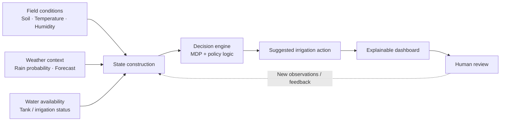
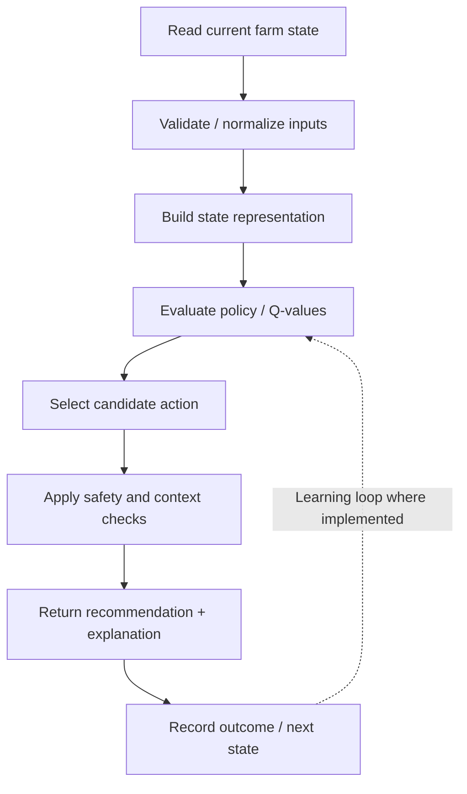
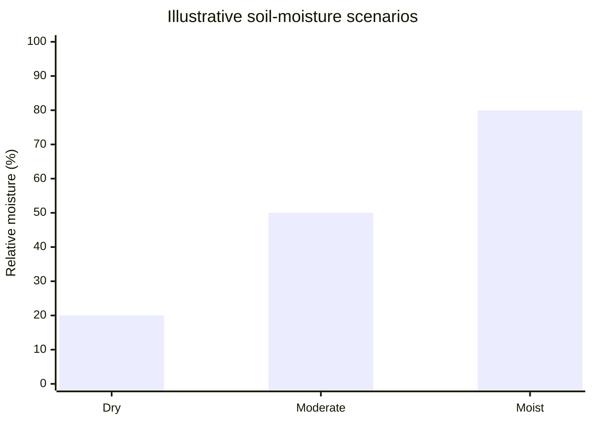
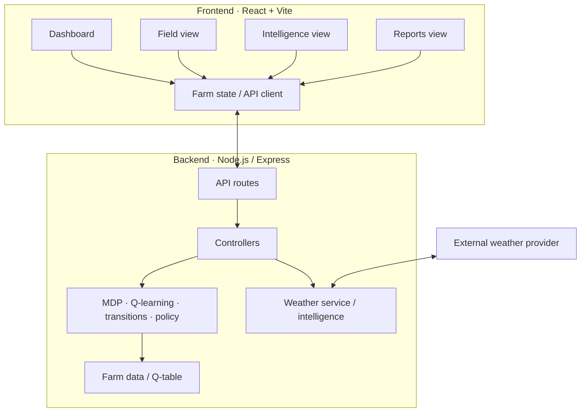
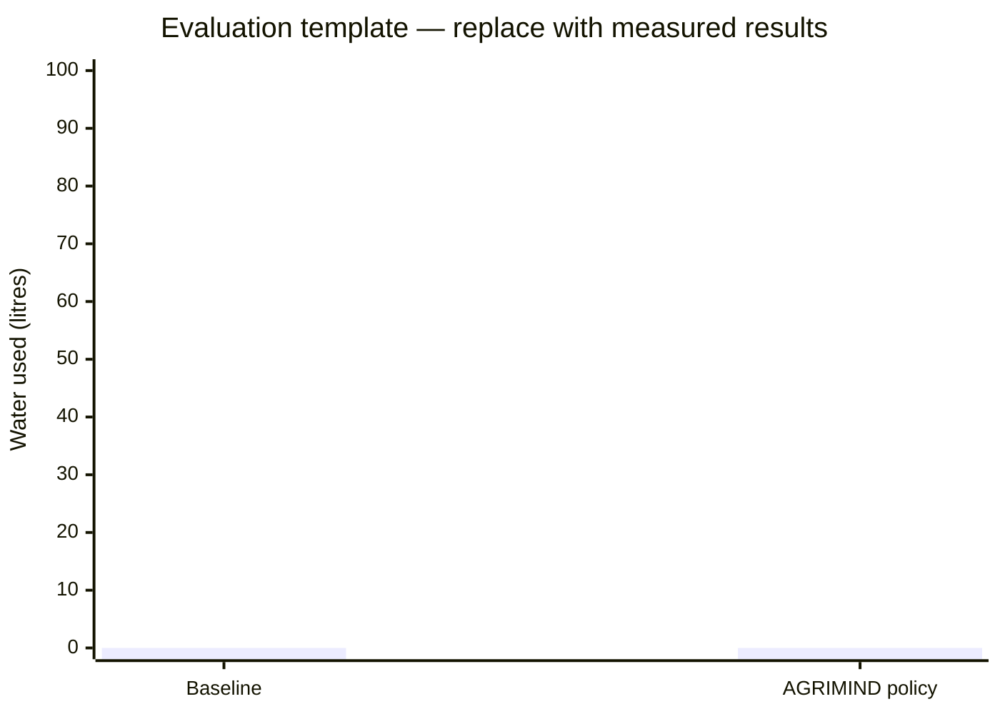

<div align="center">

# 🌱 AGRIMIND
### AI-Powered Smart Irrigation & Farm Intelligence

**From field signals to smarter irrigation decisions.**

A decision-support platform exploring how soil conditions, weather context, and Markov Decision Processes can support more deliberate, explainable, water-conscious irrigation planning.

[](./frontend)
[](./backend)
[](#-decision-intelligence)

[**Repository**](https://github.com/sainasingh03/AGRIMIND-AI-Powered-Smart-Irrigation-Farm-Intelligence-) · [**Issues & Feature Requests**](https://github.com/sainasingh03/AGRIMIND-AI-Powered-Smart-Irrigation-Farm-Intelligence-/issues)

</div>

---

## 🌾 The idea

Irrigation is a decision under uncertainty. Soil moisture may be low while rain is approaching; temperature can rise while water availability is limited. A fixed schedule cannot always express these changing conditions.

**AGRIMIND** brings farm telemetry, weather information, irrigation logic, and a visual dashboard into one workflow. It is designed to make field conditions easier to understand and show why a suggested action may be appropriate.

> **Principle:** make the state visible, make the decision understandable, and make data limitations explicit.


| 🌱 Farm state | 🧠 Decision intelligence | 📊 Operational visibility |
|---|---|---|
| Soil moisture, temperature, humidity and tank level | MDP state/action/reward concepts and policy output | Decision history, telemetry trends and water-focused summaries |
| Weather context where available | Transition logic and Q-learning components | Dashboard, Field, Intelligence and Reports views |
| Simulated-data status should be explicit | Human-readable reasoning | Charts and summaries for interpreting field conditions |

## 🎯 Problem → approach → outcome



**Intended outcome:** better-informed irrigation planning—not a claim of guaranteed water savings or autonomous pump control.

## ✨ Feature map

- **Farm dashboard** — consolidated view of farm and sensor indicators.
- **Irrigation decision workflow** — evaluates a field state and presents a recommendation.
- **MDP concepts** — states, actions, transitions and rewards for sequential decision-making.
- **Q-learning component** — includes Q-table / learning implementation for exploring action-value-based decisions.
- **Telemetry API** — serves readings to the interface; demo readings may be simulated.
- **Weather integration** — weather-service code is included; availability depends on the provider and network conditions.
- **Policy and transition views** — make decision logic easier to inspect.
- **Field, Intelligence and Reports pages** — separate monitoring, decision-focused information and reporting UI.
- **Responsive React interface** — built with React and Vite.

> **Data honesty:** unless real sensors are connected and verified, telemetry should be treated as simulated/demo data. Weather may be unavailable or rate-limited. The repository does not by itself prove physical pump actuation, production readiness or measured water savings.

## 🧠 Decision intelligence

AGRIMIND explores irrigation as a sequential decision problem.

| MDP element | Interpretation |
|---|---|
| **State** | Representation of observed farm conditions such as moisture, temperature, humidity, rainfall context and water availability |
| **Action** | A candidate irrigation decision defined by the current implementation |
| **Transition** | How the system represents movement from one state to another |
| **Reward** | Value used by the decision/learning logic to express desirable outcomes |
| **Policy** | Strategy for selecting an action for a state |

### Decision pipeline



### Illustrative moisture scenarios

**Conceptual illustration only — not live sensor data or experimental results.**



## 🏗️ System architecture



## 📁 Repository structure

```text
AGRIMIND/
├── frontend/                   # React + Vite interface
│   ├── src/
│   │   ├── components/         # Dashboard and decision visualizations
│   │   ├── context/            # Farm/application state
│   │   ├── data/               # Demo data and field geometry
│   │   └── pages/              # Dashboard, Field, Intelligence, Reports
│   └── package.json
├── backend/
│   ├── app/                    # Python learning/agent modules
│   ├── src/
│   │   ├── controllers/
│   │   ├── routes/
│   │   ├── services/           # MDP, Q-learning, weather, transitions
│   │   └── data/
│   └── package.json
├── models/                     # Saved Q-table/model artifact
├── README.md
└── .gitignore
```

The repository includes both JavaScript backend modules and a Python `backend/app` learning/agent area. Treat them as separate components unless their integration has been explicitly configured and tested.

## 🛠️ Technology stack

| Layer | Technologies present in the repository |
|---|---|
| Frontend | React, Vite, JavaScript, CSS |
| API backend | Node.js, Express |
| Decision logic | MDP-style decision engine, Q-learning engine, transition and policy services |
| Python learning area | Python agent, environment and training modules |
| Weather | Weather-service integration (provider/network dependent) |
| Visualization | Dashboard cards, field views, decision visualizations and reports UI |

## 🚀 Run locally

### Prerequisites
- Node.js and npm
- Python 3.11+ if using the Python learning modules
- Git

### 1. Clone the repository

```bash
git clone https://github.com/sainasingh03/AGRIMIND-AI-Powered-Smart-Irrigation-Farm-Intelligence-.git
cd AGRIMIND-AI-Powered-Smart-Irrigation-Farm-Intelligence-
```

### 2. Start the frontend

```bash
cd frontend
npm install
npm run dev
```

Open the local URL printed by Vite.

### 3. Start the Node backend

Open a second terminal from the repository root:

```bash
cd backend
npm install
npm start
```

Check `backend/package.json` for the actual script name. If `npm start` is not defined, use the script listed there (for example, `npm run dev` if provided).

### 4. Python learning modules (optional)

Create and activate a virtual environment and install the Python dependencies listed by the project, if a `requirements.txt` is present. Run the Python modules using their own entry points; they are not automatically started by the frontend command.

## 🔌 API surface

The Node backend is organized around these route groups; verify exact paths and methods in the route files before relying on them.

| Route group | Responsibility |
|---|---|
| `/health` | Server health check |
| `/api/irrigation` | Farm state, policy and irrigation decisions |
| `/api/sensor` | Sensor telemetry |
| `/api/weather` | Current weather and forecast |

Example health check (adjust the port to match server configuration):

```bash
curl http://localhost:5000/health
```

## 📊 Metrics & evaluation

Meaningful evaluation requires recorded observations, not invented headline numbers.

| Metric | Evaluation method |
|---|---|
| Water per irrigation cycle | Compare measured water volume under a baseline and the decision policy |
| Soil moisture after irrigation | Compare post-action moisture with a crop-specific target range |
| Decision latency | Measure request-to-recommendation time |
| Recommendation stability | Count unnecessary action flips across similar states |
| Weather resilience | Test missing, stale and rate-limited responses |
| Policy quality | Evaluate cumulative reward on held-out scenarios and document reward design |

### Results chart template

Replace this with measured experimental data before reporting performance. The values below are placeholders.



## 🔐 Safety, limitations & responsible use

- **Decision support, not autonomous irrigation:** do not connect pumps or valves without hardware integration, fail-safe controls and field testing.
- **Demo telemetry:** simulated readings are not physical sensor measurements.
- **Weather dependency:** API limits, connectivity or stale responses can affect weather information.
- **Model validity:** Q-learning quality depends on state/action design, reward design, training coverage and evaluation. A saved Q-table alone does not establish accuracy.
- **Agronomic context matters:** crop, soil type, growth stage, irrigation method and local conditions must be considered. Recommendations should be reviewed before real-world use.
- **No unsupported performance claims:** water savings, yield improvements and model accuracy should only be reported after controlled measurement.

## 🗺️ Roadmap

- [ ] Add real dashboard screenshots and a short demo recording
- [ ] Add reproducible MDP/Q-learning experiments and evaluation results
- [ ] Add automated backend tests and API examples
- [ ] Add weather caching, rate-limit handling and stale-data indicators
- [ ] Label sensor provenance as `SIMULATED`, `LIVE` or `STALE`
- [ ] Add authenticated, audited hardware integration with manual override and fail-safe behavior
- [ ] Document deployment and publish a demo when deployment is configured

## 🤝 Contributing

1. Fork the repository.
2. Create a branch: `git checkout -b feat/your-feature`.
3. Make a focused change and test it.
4. Commit: `git commit -m "feat: describe your change"`.
5. Push the branch and open a pull request.

Never commit `.env` files, credentials, virtual environments, caches or generated dependency folders.


## 👩‍💻 Maintainer

**Saina Singh** · [@sainasingh03](https://github.com/sainasingh03)

---

<div align="center">

**🌱 AGRIMIND — Make every irrigation decision more visible, reasoned and data-aware.**

<sub>An engineering project exploring decision intelligence for sustainable irrigation.</sub>

</div>
